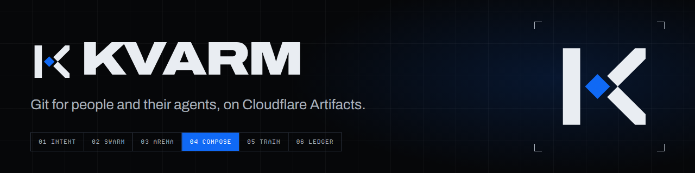
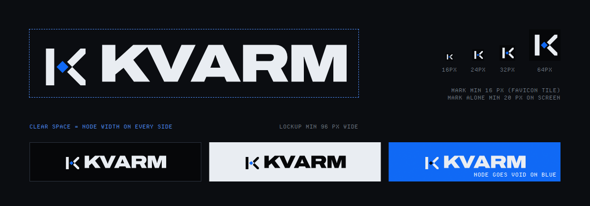

# Kvarm visual identity

Kvarm is an invented Nordic-style spelling of "swarm": many hands, one tree. The identity is neo-brutalist with a machine-interface feel. It uses near-black grounds, hairline geometry, monospace annotation and a single electric-blue ink. Every element has to carry information; decoration that tells the reader nothing is cut.

Tokens live in [`packages/ui/src/tokens.css`](../packages/ui/src/tokens.css). The Worker serves an identical copy at `/assets/tokens.css`, and a test keeps the two identical. Brand assets live in [`apps/platform/public/assets/brand/`](../apps/platform/public/assets/brand/).

## Principles

- **One ink per surface.** Swarm Blue marks the one thing that matters: the merge node, the primary action, the selected or running item. Silver and bone do the structural work.
- **Heat means contention.** The thermal ramp is used only for overlap, conflict, risk and incidents, never as decoration.
- **Hard edges.** No border radius, 1px hairlines, corner brackets and HUD labels.
- **Dark only.** There is no light theme. The ink variants of the mark exist for third-party light surfaces such as slides and partner pages.

## Mark

The mark is a K drawn on a 48-unit grid:

- a 9-unit stem;
- two arms at exactly 45°;
- a blue diamond, the merge node, where the arms would meet.

Both arms stop 2.5 units short of the node, so every branch converges on one tree without touching it. Only the node takes the ink.

| file | use |
| --- | --- |
| `mark.svg`, `mark-{64,256,1024}.png` | bone mark on dark grounds (transparent PNG) |
| `mark-ink.svg` | void mark on light grounds |
| `avatar.svg`, `avatar-{512,1024}.png` | square avatar tile (mark on void) |
| `favicon.svg`, `/favicon.ico` (16/32/48), `apple-touch-icon.png`, `icon-{192,512}.png`, `icon-512-maskable.png`, `site.webmanifest` | browser and home-screen icons |

**Clear space:** the width of the node on every side.

**Minimum size:**

- the mark alone: 20px on screen;
- the favicon tile (mark on void): 16px;
- the lockup: 96px wide.

**Backgrounds:**

- On void or carbon, use the bone mark with a blue node.
- On light grounds, use the ink variant.
- On Swarm Blue, the node turns void. Never put a blue node on blue.

Don't:

- rotate, outline, add gradients to or re-space the mark;
- recolour the stem;
- put the mark on the thermal ramp.

## Wordmark and lockup

The wordmark is KVARM set in Archivo at weight 900 and 125% width with −0.04em tracking and kerning on, converted to outlines. It doesn't depend on a font being installed.

In the lockup, the mark's stem height equals the wordmark's cap height, and the gap between them is 0.45× the cap height.

| file | use |
| --- | --- |
| `lockup.svg`, `lockup.png` | primary lockup on dark |
| `lockup-ink.svg`, `lockup-ink.png` | lockup on light |
| `wordmark.svg`, `wordmark-ink.svg`, `wordmark.png` | where the mark already appears nearby |

Always write the name in running text as "Kvarm". The all-caps form appears only in the wordmark artwork.

## Colour

Contrast ratios are WCAG 2.x, measured against `--void`, `--carbon` and `--graphite`. The token test fails if any text colour drops below AA (4.5:1) on any of them.

| token | hex | role | on void |
| --- | --- | --- | ---: |
| `--void` | `#050608` | page ground | — |
| `--carbon` | `#0a0c10` | panels | — |
| `--graphite` | `#11141a` | raised panels | — |
| `--hairline` / `--hairline-2` | `#1e232c` / `#2c333e` | rules and borders (never text) | — |
| `--steel` | `#7a8390` | secondary text, HUD labels | 5.29 |
| `--silver` | `#a9b1bc` | body text | 9.36 |
| `--bone` | `#e9edf2` | headings, primary text | 17.24 |
| `--signal` (Swarm Blue) | `#0f67f5` | fills, mark node, display text ≥ 24px | 4.13 |
| `--signal-hi` | `#4d8dff` | links, small blue text, focus | 6.34 |
| `--heat-0` … `--heat-4` | `#1b1f6b` → `#ffc94d` | contention, conflict and risk only | — |

White text on Swarm Blue (primary buttons) is 4.91:1.

`--signal` is below 4.5:1 as text, so use it only for fills and for large display type (WCAG large text, 3:1). For any body-size blue text, use `--signal-hi`.

## Type

| family | role | file |
| --- | --- | --- |
| Archivo (variable, wdth 62–125, wght 100–900) | display and UI text | `archivo-latin-wdth-normal.woff2` |
| JetBrains Mono | code, diffs, SHAs, numbers | `jetbrains-mono-latin-wght-normal.woff2` |
| Departure Mono | HUD and telemetry labels (uppercase, +0.06em) | `DepartureMono-Regular.woff2` |
| Instrument Serif Italic | rare editorial accent, at most one line per view | `instrument-serif-latin-400-italic.woff2` |

- Display headings are Archivo 800 at 125% width, uppercase, with −0.035em tracking.
- The type scale is 11, 12, 14, 16, 20, 28, 40, 64 and 112px (`--t-hud` … `--t-4xl`).
- Spacing runs on a 4px base (`--s1` … `--s10`).

## Motion

- Telemetry ticks in steps (`--step: steps(4, end)`) rather than easing; layout motion uses `--ease`.
- Motion always communicates state: live claims, a running train, an arriving event. Nothing loops just for decoration.
- Everything stops under `prefers-reduced-motion: reduce`.

## Link preview and README

- `og.png` (1200×630) is the Open Graph link preview image shown when a Kvarm URL is pasted into chat apps.
- [`docs/brand/readme-header.png`](brand/readme-header.png) heads the README.

## Sources and licenses

- **Original work.** The mark, wordmark artwork, lockups, icons, link preview image and README header were made for Kvarm and are covered by the repository's MIT license.
- **Fonts.** All four families are under the SIL Open Font License 1.1. The license texts sit next to the files in [`apps/platform/public/assets/fonts/`](../apps/platform/public/assets/fonts/). The wordmark outlines are artwork drawn with Archivo, not a copy of the font software.
- **Reference images.** The images used for aesthetic direction are third-party and are not part of this repository. They stay local in `planning/aesthetic/`, which is gitignored.
